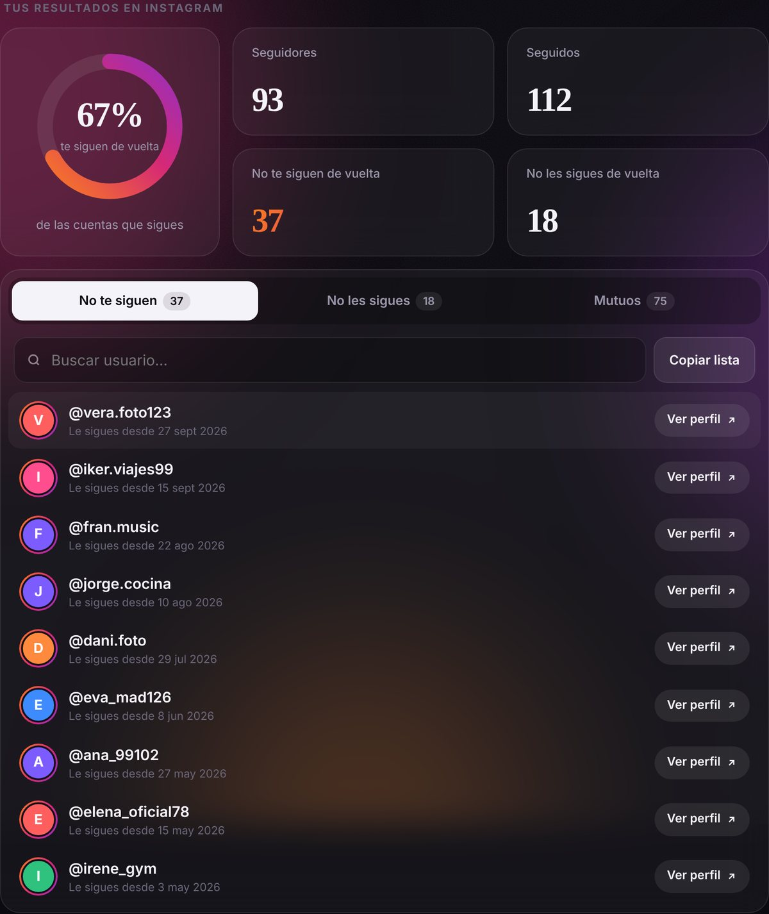
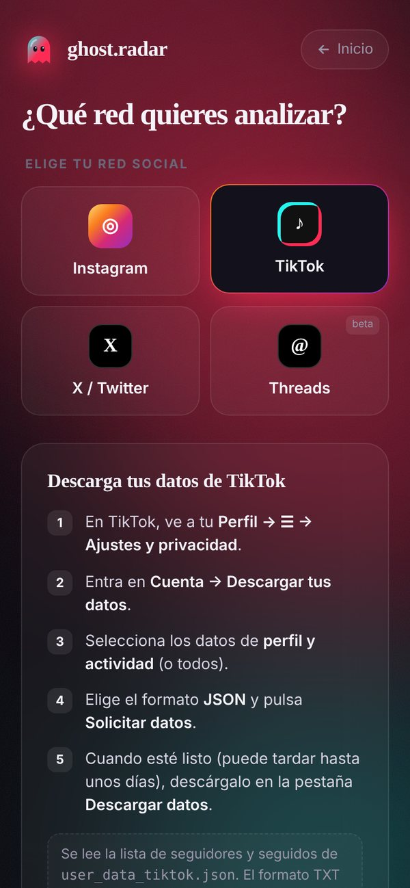
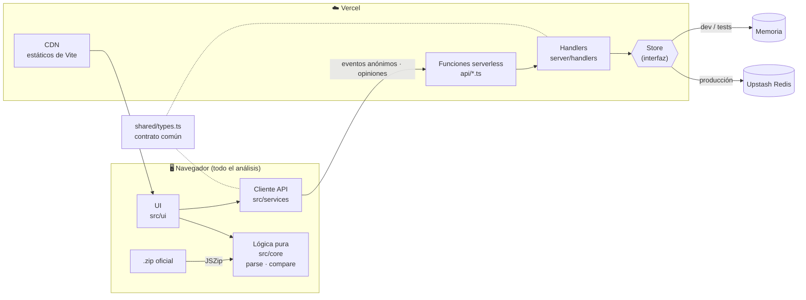

<div align="center">


# ghost.radar

**Descubre quién no te sigue de vuelta en Instagram, TikTok, X y Threads.**
Sin contraseñas, sin extensiones y sin que tus datos salgan de tu dispositivo.

[](https://github.com/jmm-21/ghost-radar/actions/workflows/ci.yml)


<!-- Sustituye el enlace por tu URL de Vercel cuando despliegues -->
[**Probar la demo →**](https://ghost-radar.vercel.app)


</div>

---

## ✨ Qué hace

| | |
|---|---|
| 👻 **No te siguen de vuelta** | Las cuentas que sigues y que no te siguen. |
| 💌 **No les sigues de vuelta** | Quién te sigue y a quién todavía no sigues tú. |
| 🤝 **Mutuos** | Os seguís mutuamente, con la fecha desde la que os seguís. |
| 📊 **Resumen visual** | Porcentaje de seguimiento mutuo y contadores animados. |
| 🔎 **Buscar y copiar** | Filtra por nombre, abre perfiles y copia cualquier lista. |

<p align="center">
  
  
</p>

## 🔒 Privacidad por diseño

La mayoría de las apps de "unfollowers" piden tu contraseña. Eso va contra las normas de las redes sociales y acaba en bloqueos o en cuentas robadas. **ghost.radar funciona al revés:**

1. Descargas tus datos desde la página **oficial** de cada red.
2. Subes el `.zip` a ghost.radar.
3. El archivo se lee y se compara **en tu navegador**. No se envía a ningún servidor.

El backend solo recibe dos tipos de datos anónimos: el aviso "se ha hecho un análisis en Instagram" (para el contador público) y las opiniones que alguien envía voluntariamente. Nunca recibe nombres de usuario, listas ni archivos. Para limitar peticiones se usa un hash con sal que cambia cada día: **la IP no se guarda**.

## 🏗️ Arquitectura



Decisiones principales (ver [docs/ARCHITECTURE.md](docs/ARCHITECTURE.md)):

- **Lógica pura y testeable.** Leer y comparar los archivos no depende del DOM ni de la red, así que se prueba con tests unitarios.
- **Contrato compartido.** `shared/types.ts` define los tipos que usan el frontend y la API. Si uno cambia sin el otro, TypeScript da error.
- **Handlers independientes de la plataforma.** Reciben un `Request` y devuelven un `Response` estándar. Funcionan igual en Vercel, en el servidor de desarrollo y en los tests.
- **Inversión de dependencias en el almacenamiento.** Los handlers usan la interfaz `Store`. En producción hay Redis y en desarrollo, memoria, así que el proyecto arranca sin configurar nada.

### Estructura

```
ghost-radar/
├── index.html              # Maquetación (portada + herramienta)
├── src/
│   ├── core/               # Lógica pura: lectores de cada red, comparación, .zip
│   ├── config/             # Instrucciones y enlaces de cada red social
│   ├── ui/                 # Componentes de interfaz (sin frameworks, sin innerHTML con datos del usuario)
│   ├── services/           # Cliente HTTP de la API
│   └── styles/             # CSS (tema dinámico por red social)
├── shared/                 # Tipos compartidos frontend ↔ backend
├── api/                    # Puntos de entrada serverless (Vercel)
├── server/
│   ├── handlers/           # Lógica de cada endpoint
│   └── lib/                # Store (Redis/memoria), límite de peticiones, utilidades HTTP
├── tests/                  # Vitest: lectores, comparación y API
└── .github/workflows/      # Integración continua
```

## 🔌 API

| Método | Ruta | Descripción |
|---|---|---|
| `GET` | `/api/health` | Estado del servicio y tipo de almacenamiento. |
| `POST` | `/api/events` | Registra un evento anónimo `{ type, network }`. Límite: 30/min. |
| `GET` | `/api/stats` | Contador público de análisis por red (con caché en el CDN de 60 s). |
| `POST` | `/api/feedback` | Envía una opinión `{ message, rating?, contact? }`. Límite: 5/hora. |
| `GET` | `/api/feedback` | Lista las opiniones. Requiere `Authorization: Bearer $ADMIN_TOKEN`. |

## 🌐 Formatos soportados

| Red | Archivos | Notas |
|---|---|---|
| Instagram | `followers_1.json`, `following.json` (o HTML) | Formatos de exportación antiguo y nuevo. |
| TikTok | `user_data_tiktok.json` o `Follower.txt` / `Following.txt` | Estructura JSON antigua y actual. |
| X / Twitter | `data/follower.js`, `data/following.js` | X solo exporta ids numéricos, no nombres. |
| Threads *(beta)* | Exportación de Meta (carpeta `threads`) | |

## 🚀 Empezar

Requisitos: **Node 20 o superior**.

```bash
git clone https://github.com/jmm-21/ghost-radar.git
cd ghost-radar
npm install
npm run dev          # frontend + API en http://localhost:5173
```

| Script | Qué hace |
|---|---|
| `npm run dev` | Servidor de desarrollo con la API incluida. |
| `npm test` | Tests (Vitest). |
| `npm run test:coverage` | Tests con informe de cobertura. |
| `npm run typecheck` | Comprobación de tipos estricta. |
| `npm run build` | Comprueba los tipos y genera `dist/`. |

Las variables de entorno son opcionales. Consulta [`.env.example`](.env.example).

## ☁️ Despliegue

Se despliega en **Vercel** con un clic, gratis: la web va al CDN y `api/` se convierte en funciones serverless. La guía completa (Redis, dominio propio, variables) está en [docs/DEPLOY.md](docs/DEPLOY.md).

## 🛡️ Seguridad

- Política de seguridad de contenido estricta: sin scripts ni estilos en línea, y solo se conecta a su propio dominio.
- Validación de todas las entradas en el servidor y límite de tamaño del cuerpo de las peticiones.
- Límite de peticiones por cliente anónimo.
- El texto del usuario nunca se inserta como HTML.

## 🗺️ Próximos pasos

- [ ] Comparar dos exportaciones para ver **quién te ha dejado de seguir**.
- [ ] Instalable como app (PWA) y funcionamiento sin conexión.
- [ ] Exportar resultados a CSV.
- [ ] Versión en inglés.

## 👤 Autor

**Jorge Méndez Martínez** · [GitHub @jmm-21](https://github.com/jmm-21)

¿Ideas, errores o propuestas? Abre un [issue](https://github.com/jmm-21/ghost-radar/issues) o usa el botón de opiniones de la web.

## 📄 Licencia

[MIT](LICENSE) © 2026 Jorge Méndez Martínez. ghost.radar no está afiliado a Meta, TikTok ni X.
