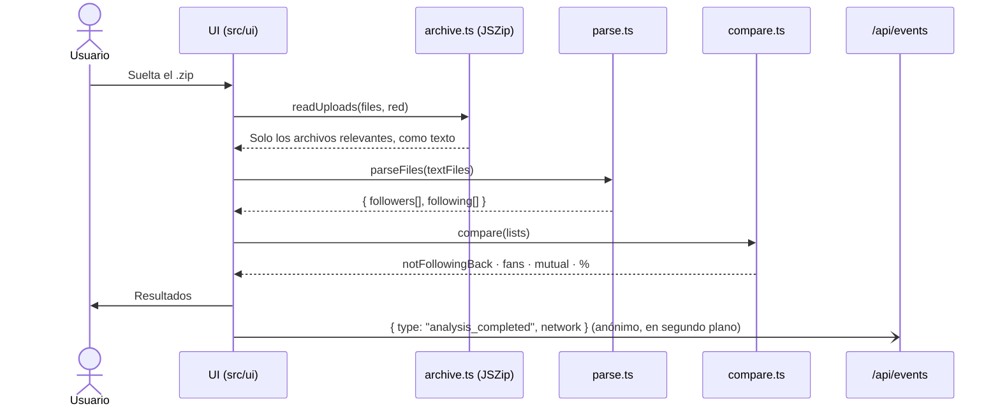

# Arquitectura de ghost.radar

Este documento explica **por qué** el proyecto está construido así. El **qué** está en el [README](../README.md).

## Objetivo y restricciones

- **Privacidad.** Los archivos del usuario contienen su red social completa y nunca deben salir de su dispositivo.
- **Coste cero.** El proyecto tiene que poder desplegarse en planes gratuitos.
- **Mantenible por una persona.** Pocas dependencias y sin magia.

## Flujo de un análisis

El evento se envía con `keepalive` y sus errores se ignoran: si la API falla, el usuario no se entera.

## Decisiones

### 1. El análisis ocurre en el cliente

**Alternativa descartada:** subir el `.zip` al servidor y procesarlo allí.
**Motivo:** sería pedir al usuario que confíe en nosotros con toda su red social. Procesarlo en el navegador elimina ese riesgo y además no tiene coste de servidor.

### 2. Un único lector genérico en vez de uno por red

Las exportaciones cambian de estructura a menudo (Instagram movió el nombre de usuario de `value` a `title`, y TikTok renombró `Activity` a `Your Activity`). En lugar de depender de rutas exactas, `parse.ts`:

1. Recorre el JSON entero.
2. Detecta los arrays cuyos elementos parecen cuentas (`extractAccount`).
3. Los clasifica según la clave más profunda de su ruta (`classify`), por ejemplo `FansList` → seguidores.
4. Descarta las listas que se parecen pero no son seguidores (`EXCLUDE`: hashtags, solicitudes pendientes, bloqueados…).

Así, los cambios menores de formato se absorben sin tocar el código, y los tests cubren las variantes conocidas.

### 3. Tipos compartidos (`shared/`)

El frontend y la API importan los mismos tipos (`Network`, `AnalyticsEvent`, `FeedbackInput`…). Si se añade una red o un evento, el compilador señala todos los sitios que hay que actualizar a ambos lados.

### 4. Handlers con `Request` y `Response` estándar

`server/handlers` no sabe nada de Vercel. Cada endpoint es una función `(Request, Deps) => Promise<Response>`:

- `api/*.ts` son adaptadores de tres líneas para Vercel.
- `vite.config.ts` monta las mismas funciones en desarrollo.
- Los tests llaman a los handlers directamente, sin levantar un servidor.

Migrar a Cloudflare Workers, Deno o Express solo requiere escribir adaptadores nuevos.

### 5. `Store` como interfaz

| Implementación | Cuándo |
|---|---|
| `RedisRestStore` | Producción: Upstash Redis por HTTP (funciona en serverless, sin conexiones persistentes). |
| `MemoryStore` | Desarrollo y tests: sin configurar nada. |

Las operaciones de cada petición se envían a Redis juntas, en una sola llamada (pipeline), para reducir la latencia.

### 6. Límite de peticiones con ventana fija

Se calcula una clave `rl:<ámbito>:<hash del cliente>:<ventana>`, se incrementa con `INCR` y caduca con `EXPIRE`. Es simple, funciona entre instancias serverless (el estado vive en Redis) y basta para frenar abusos básicos. El hash usa una sal y la fecha del día, así que no permite seguir a nadie de un día para otro.

### 7. Sin framework de UI

La interfaz tiene dos pantallas y una lista. Un framework añadiría peso y complejidad sin aportar nada. Se usa TypeScript con un pequeño helper `h()` que crea elementos con `textContent`, de modo que el texto del usuario nunca se interpreta como HTML. Esto también permite una CSP estricta, sin `unsafe-inline`.

## Pruebas

| Capa | Qué se prueba |
|---|---|
| `tests/parse.test.ts` | Cada formato de cada red, exclusiones, archivos corruptos. |
| `tests/compare.test.ts` | Comparación, duplicados, ordenación, búsqueda. |
| `tests/api.test.ts` | Endpoints, validación, límites, autorización y almacenamiento (con `fetch` simulado para Redis). |

La CI (GitHub Actions) ejecuta la comprobación de tipos, los tests con cobertura y el build en cada push y en cada pull request.
